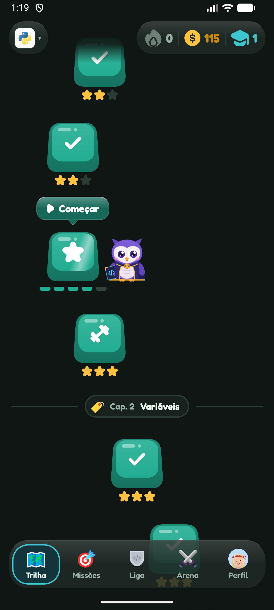
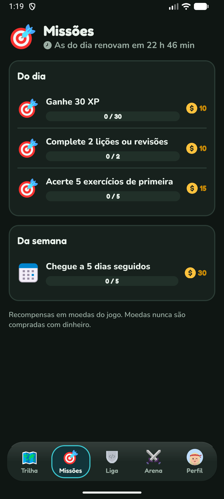
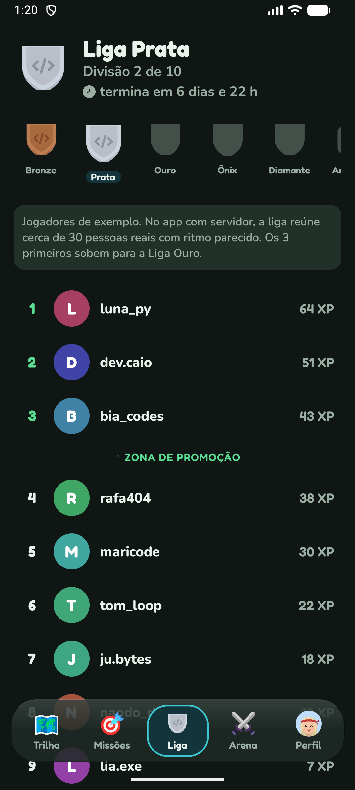
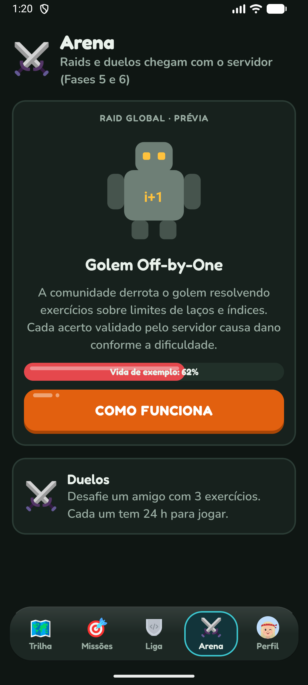
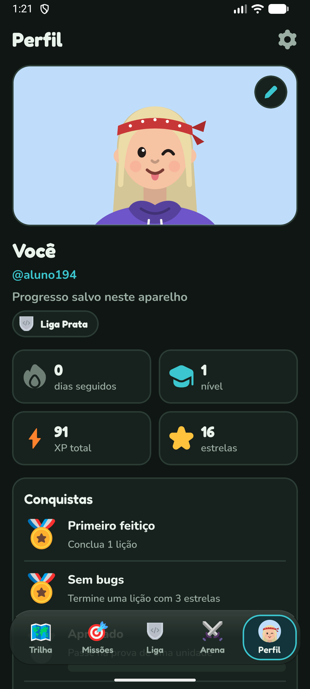
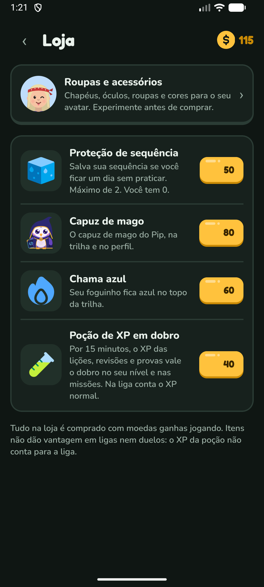
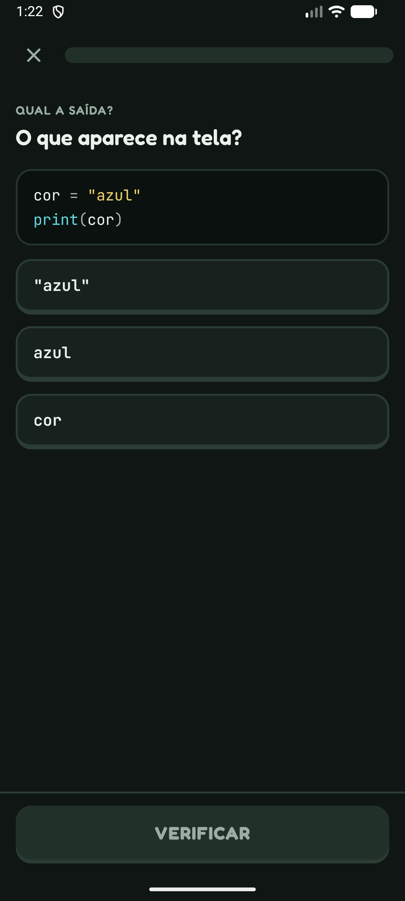

# Arcode

**Aprenda a programar de verdade, no celular, um passo por dia.**

App Android e iOS que ensina programação real com trilha de progresso, lições curtas,
desafios em que você escreve o código e um mascote que acompanha cada passo.

---

## Telas

<table>
  <tr>
    <td align="center"> <b>Trilha</b>: unidades, capítulos, revisões e provas</td>
    <td align="center"> <b>Missões</b> diárias e semanais</td>
    <td align="center"> <b>Liga</b> semanal com 10 divisões</td>
  </tr>
  <tr>
    <td align="center"> <b>Arena</b>: duelos e raids (prévia)</td>
    <td align="center"> <b>Perfil</b> com avatar personalizável</td>
    <td align="center"> <b>Loja</b> com moedas do jogo</td>
  </tr>
  <tr>
    <td align="center"> <b>Exercícios</b> curtos com código de verdade</td>
    <td></td><td></td>
  </tr>
</table>

## O que é

O Arcode nasceu de uma pergunta simples: **e se aprender a programar fosse tão fácil de manter
quanto um joguinho diário, sem deixar de ser aprendizado de verdade?**

Cada lição leva poucos minutos e mistura explicação curta com exercícios de tocar, arrastar,
completar e escrever código. Para avançar, a pessoa precisa **dominar** o conteúdo: cada capítulo
termina numa revisão e cada unidade numa prova, as duas com mínimo de 70% de acerto. Não dá para
pular etapas.

## Destaques

- **Curso completo de Python**: 16 unidades, 48 capítulos, 126 lições e cerca de 950 exercícios,
  do primeiro `print` até web com Flask. Todo código do curso é conferido automaticamente num
  Python de verdade antes de entrar no app.
- **Python rodando no próprio celular**: nos desafios "Escreva o programa", a pessoa escreve o
  código, toca em **Rodar** e vê o resultado. Funciona sem internet e sem servidor. A correção
  aceita qualquer jeito certo de resolver: confere o resultado, não a forma.
- **34 desafios práticos**: 4 no caminho principal (gorjeta, adivinhe o número, agenda e diário)
  e 30 opcionais na lateral da trilha.
- **"Por que errei?"**: conversa guiada que explica o erro com o conteúdo do próprio curso.
- **Gamificação que recompensa aprender**: XP por acerto e rapidez, sequência de dias (o
  "foguinho"), missões, liga semanal com 10 divisões, loja e avatar personalizável. Sem loot box e
  sem dinheiro real.
- **Pip**, a coruja maga mascote, com humores, animações e lembretes amigáveis.
- **8 tipos de exercício**: escolha, montar a linha, ordenar arrastando, completar, tocar, ligar
  pares, "escreva a saída" e escrever o programa.
- **Acessível e confortável**: tema claro e escuro, opção de reduzir animações, sons e vibração.

## Privacidade

- Todo o progresso fica **só no aparelho**. O app não tem anúncios, rastreamento nem analytics.
- Nada é enviado pela internet, e o backup automático do Android fica desligado.
- Em **Configurações → Seus dados**, a pessoa pode apagar tudo a qualquer momento.
- O app pede só o necessário: nada de microfone, câmera, localização ou contatos.
- Na tela de bloqueio, os lembretes não mostram o texto da mensagem.

## Tecnologia

| Camada | Escolha |
|---|---|
| App | React Native 0.88 + Expo SDK 58, TypeScript, Expo Router |
| Estado | Zustand com persistência local |
| Python no aparelho | Pyodide em um Web Worker isolado, com limite de passos e de tempo |
| Conteúdo | curso escrito como código, gerado e validado por scripts |
| Gráficos | SVG próprio (mascote, avatar, trilha), animações com Reanimated |
| Planejado | backend autoritativo (Supabase/Postgres) para contas, liga real, duelos e raids |

## Estado do projeto

| Fase | Situação |
|---|---|
| Planejamento (viabilidade, arquitetura, banco de dados, segurança, roadmap) | ✅ concluído |
| App offline com o curso de Python completo | ✅ funcionando (Android) |
| Python no aparelho e desafios de escrever código | ✅ funcionando (Android) |
| Contas, liga real, duelos e raids (servidor) | 🔜 próxima fase |
| iOS | 🔜 depois do servidor |
| Publicação nas lojas | 🔜 |

## Direitos autorais

© 2026 Gabriel Kono. **Todos os direitos reservados.**

Este é um projeto **proprietário**. O código-fonte não é público. Este repositório serve para
apresentar o projeto, e nenhuma parte dele (textos, imagens, mascote, interface) pode ser copiada,
modificada, redistribuída ou usada sem autorização por escrito. Veja [LICENSE](LICENSE).

Créditos de terceiros: ícones UIcons (Flaticon), Fluent Emoji (Microsoft, MIT), logos Devicon
(MIT), fontes Fredoka, Nunito e JetBrains Mono (SIL OFL 1.1) e Pyodide (MPL-2.0). Detalhes em
[THIRD_PARTY_NOTICES.md](THIRD_PARTY_NOTICES.md).

Interesse em parceria, investimento ou acesso ao código? Entre em contato pelo GitHub:
[@Ogabrkr](https://github.com/Ogabrkr).
